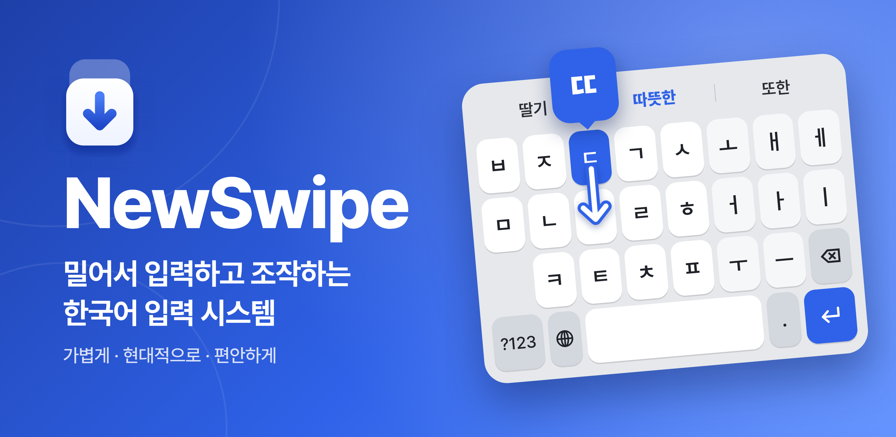
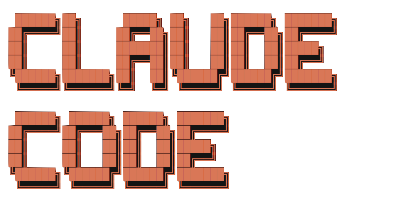

  

[한국어](README.md) · **English**

NewSwipe is a lightweight, modern and comfortable Korean keyboard.
 
 

  
  
  
  

 

# Core values

### Lightweight

An input system always runs in the background, and it has to respond promptly, whenever and wherever you need it.  
NewSwipe keeps its resource use to a minimum so it stays fast and responsive.  
It draws as few views as possible and uses no external libraries.  
The app is under 3 MB and uses less than 90 MB of RAM (measured on Android 16 device with 16 GB of RAM).  

### Modern

Being light and well optimized doesn't mean an app has to look dated or plain.  
NewSwipe keeps up with the latest Android APIs, features and UX.  
UI is inspired by Material 3 Expressive, and supports dark mode, predictive back, system autofill and Emoji 18.0.  
It also has everything you expect from a modern keyboard — clipboard, word suggestions and word learning — so you won't miss a thing.  

### Comfortable

The keyboard is one of the apps you use most on your phone, and also one of the most personal.  
Rather than forcing one experience on everyone, NewSwipe offers a wide range of customization for people who type in different ways.  
Build an input system that is truly your own, one that fits you perfectly.  
 

# Highlights
- 🛠️ **Customize** what every key does when you long press it or swipe it up, down, left or right.
- 📺 Build your own **layouts for large screens** such as tablets and foldable inner screens.
- 🇰🇷 Experience powerful **word suggestions, autocorrect and learning**, built with the particulars of Korean in mind.
- 🤟 Don't miss the **modern features**: clipboard, the latest emoji, one-handed mode, system autofill and more.
 

# Features

### ⌨️ Input
- **Swipe to type** · Swipe to type double consonants (ㄲ ㄸ ㅃ ㅆ ㅉ) and Y-vowels (ㅑ ㅕ ㅛ ㅠ ㅒ ㅖ). This avoids the ambiguity of whether a consonant ends one syllable or starts the next, and makes you type faster.
- **Long press to type** · Assign any number, symbol, accented letter or phrase to the long press of every letter key.
- **Text shortcuts** · Type a short combination of letters to bring up a phrase you set. For example, typing 'ㅈㄱㅈ' shows '지금 가는 중' ("on my way") in the suggestions.

### 🎨 Look & customization
- **Customize keyboard** · In a preview that looks just like the real keyboard, drag the handles to change height, padding and key gaps, and change each key's tap, long press and swipe actions all in one place.
- **Keyboard look** · Change the look of the keyboard in many ways, from key height, text size and padding to the layout itself.
- **Custom actions** · Choose what happens when you tap, long press, or swipe up, down, left or right on any key or area, from a wide range of actions and features.
- **Theme** · Choose light or dark mode, an accent color, and Neumorphism design.

### 🧰 Convenience
- **Toolbar** · Put buttons for handy features above (or below) the keyboard. Freely set the order, position and visibility of each button.
- **Clipboard** · Saves up to 30 recently copied texts and images for 24 hours. You can pin the ones you want to keep (up to 10). Copies marked as sensitive and copies from password fields are not saved by default.
- **Emoji** · Supports Emoji 18.0. Search in Korean or English. When you open the emoji panel, it reads the words before the cursor and suggests emoji. You can pin the emoji you use most.
- **One-handed mode** · Shifts the keyboard to the left or right to make typing with one hand easier.
- **Floating keyboard** · Place a floating keyboard anywhere you like for comfortable typing on large screens.
- **Import & export settings** · Export all your settings to a file and import them back. When the file contains personal content, you can encrypt it with a password.

### ✨ Word suggestions, autocorrect & learning
- **Suggestions that understand Korean** · Builds and suggests words based on what you type, even words that aren't in the dictionary. Supports initial-consonant search, words typed without spaces, ordering by the previous word, and next-word prediction.
- **Smart autocorrect** · Fixes swipe mistakes (ㄷ↔ㅌ↔ㄸ), typos from hitting a neighboring key, and spellings written the way they sound (재밋네요 → 재밌네요, 됬다 → 됐다). The word that will be replaced is shown in bold on the suggestion bar in advance. If a correction was wrong, press ⌫ to undo it.
- **Learns how you write** · Learns the words, names and slang you use often and shows them in the suggestions. Long press a wrong suggestion to delete it.
- **Dictionary packs** · Import a larger Korean dictionary (zip) for better accuracy.

 

# 🔒 Privacy

Privacy and security are the core value of a sound input system. NewSwipe does not collect personal information or send it off your device.
- **The app has no internet permission, so no data is ever sent anywhere.**
- Learned words and clipboard history (text and images) are kept only in the app's private storage and are not included in system backups (`allowBackup=false`).
  You can turn off saving or delete everything in Settings.
- Words are not learned in password and email fields, or in fields that ask apps not to learn (such as incognito mode).
- Learned words, emoji and clipboard history (text only) go into a backup file only if you choose to include them in 'Import & export settings',
  and you can then encrypt the whole file with a password (AES-256-GCM, with the key derived using PBKDF2-HMAC-SHA256).
 

# 🤝 NewSwipe's promise

NewSwipe is free on GitHub but sold as a paid app on Google Play. I don't charge for it to make money, though — **I'm simply curious how much good people will appreciate something I made with love.**

As the developer of NewSwipe, I, Alternative, make two promises to users;

1. NewSwipe will **stay open source**, and the APK will always be free to download from GitHub. NewSwipe's core values are based on users' trust, and open source is an essential part to that.

2. **The GitHub and Play versions of NewSwipe will be identical.** No features or perks will be reserved for paying users. There are only two reasons to buy the Play version: the convenience of **automatic updates through Google Play**, and **supporting the developer**.
 

# 💡 Inspirations

NewSwipe's layouts and input methods take ideas from the works below.
This project and its developer are not affiliated with any of their developers or designers.

- **Google Danmoeum** — the Danmoeum layout first introduced in Google Korean Input in 2010.
- **Ker Keyboard** — typing double consonants on a Danmoeum layout by swiping the key down.
- **Ortholinear keyboards** — grid alignment.
 

# 📃 Disclaimer

  </a>

NewSwipe was built by a non-programmer using **Claude Code** (Sonnet 5.5, Opus 5.5).
All ideas and reviews came from the developer, and the main features were implemented with Claude Code.
If you find anything lacking, I'd be grateful if you let me know in [GitHub Issues](https://github.com/TechTree-Alt/NewSwipe/issues).
 
 

# 📃 License

- NewSwipe's source code is licensed under the [Apache License 2.0](LICENSE). Copyright 2026 Alternative.
  This license does not grant the right to use the name "NewSwipe" or its logo as trademarks
  (Section 6 of the Apache License 2.0). If you build an app from this code, please use a different name and icon.
- The **NewSwipe Danmoeum** layout design is licensed under [CC BY-NC 4.0](LICENSE-LAYOUT.md). You may use it freely for non-commercial purposes with attribution,
  but **using it in another commercial keyboard app requires the author's permission** (the Apache License 2.0 does not separately grant rights to this layout design).
- The emoji data is under the Unicode License v3; the Korean dictionary is under CC BY 4.0 (Leipzig Corpora Collection) and CC0 (NSMC);
  and the English dictionary is under MIT (SymSpell), CC BY 3.0 (Google Books Ngram) and the SCOWL license.
- The spelling-mistake rules for Korean autocorrect were selected from the typo list of
  [open-korean-text](https://github.com/open-korean-text/open-korean-text) (Copyright 2014 Twitter, Inc.) and the typo definitions of
  [Kiwi](https://github.com/bab2min/Kiwi) (Copyright 2017-2026 Minchul Lee and the Kiwi contributors).
  The list of verb and adjective stems used to build the dictionary (`dict/lists/ko_stems_kiwi.txt`) was made by analyzing a corpus with Kiwi (kiwipiepy)
  and filtering it with open-korean-text's verb and adjective lists. Both projects are under the Apache License 2.0, and Kiwi is not included in the app.
  See [THIRD_PARTY_NOTICES.md](THIRD_PARTY_NOTICES.md) for details.
