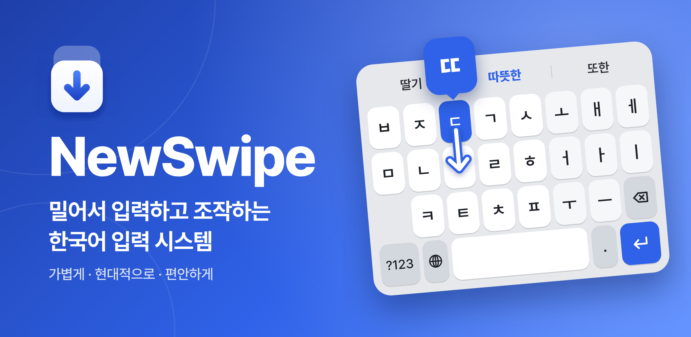
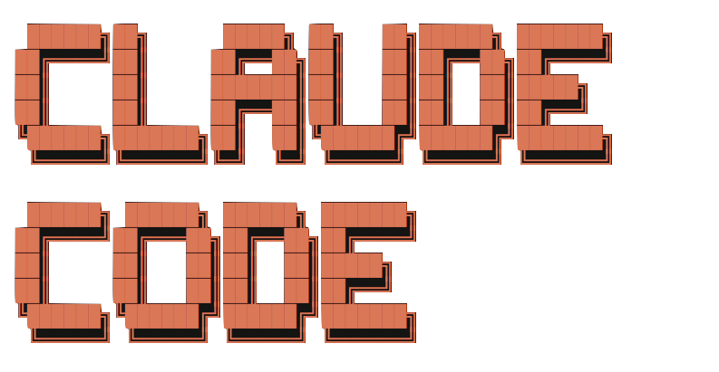

<p align="center">
  
</p>
NewSwipe는 가볍고 현대적이며 편안한 한국어 입력 시스템입니다.
<br />
<br />
<p align="left">
  <a href="https://github.com/TechTree-Alt/NewSwipe/releases/latest"></a>
  <a href="https://techtree.tistory.com/280"></a>
  <a href="https://apps.obtainium.imranr.dev/redirect?r=obtainium://app/%7B%22id%22%3A%22com.alternative_studios.newswipe%22%2C%22url%22%3A%22https%3A%2F%2Fgithub.com%2FTechTree-Alt%2FNewSwipe%22%2C%22author%22%3A%22TechTree-Alt%22%2C%22name%22%3A%22NewSwipe%22%7D">
  </a>
  <a href="https://fairy.hada.io/@newswipe"></a>
</p>
<br />

# 핵심 가치

### 가벼움 (Lightweight)

입력 시스템은 항상 백그라운드에서 상주하며 언제 어느 상황에서나 적절하게 반응해야 합니다.  
NewSwipe는 자원 소모를 최소화하여 빠르고 기민하게 반응합니다.  
View를 최소한으로 그리고 외부 라이브러리를 최소한으로 사용합니다.  
앱 크기는 2MB 미만, 램 점유율은 90MB 미만입니다 (안드로이드 16, 램 16GB 기기 기준).  

### 현대적 (Modern)

가볍고 최적화가 잘 되어 있는 앱이라고 해서 딱딱하고 불친절할 필요는 없습니다.  
NewSwipe는 최신 안드로이드 API와 기능을 적극적으로 사용해 트렌드를 따라갑니다.  
Material 3 Expressive에서 영감을 받은 UX를 사용하며, 다크 모드, Predictive Back Design, 시스템 자동 완성, Emoji 18.0을 지원합니다.  
가벼움을 유지하면서도 현대적인 입력기의 다양한 편의 기능(클립보드, 단어 추천, 단어 학습)을 제공합니다.  

### 편안함 (Comfortable)

입력 시스템은 스마트폰에서 가장 많이 쓰는 앱 중 하나이며, 동시에 가장 개인적인 앱이기도 합니다.  
NewSwipe는 하나의 경험을 모두에게 강제하지 않고, 다양한 사용 방식을 가진 사용자를 위해 다양한 사용자화 기능을 제공합니다.  
자신에게 딱 맞는 편안한 입력을 위해, 단 하나뿐인 입력 시스템을 직접 만드세요.  
<br />

# 특징
- ⬇️ 친숙한 기본 단모음에 **밀어서 입력** 방식을 더하여 빠르고 시원한 타이핑을 즐기세요.
- 👐 양손 사용에 최적화된, 새로운 **NewSwipe 단모음** 배열을 사용해 보세요.
- 🥁 자음을 왼손, 모음을 오른손에 분리하는 **균형 배열**으로 예측 가능하고 박자감 있게 입력하세요.
- 📺 폴더블 내부 화면과 가로 모드에서 **분리 모드**를 써서 편안하게 입력하세요.
- 🛠️ 모든 키를 길게 누를 때와 상하좌우로 밀 때 어떤 기능을 할 지 **직접 사용자화**하세요.
- 🇰🇷 한국어의 특수성을 고려한 강력한 **단어 추천, 자동 수정, 학습** 기능을 체감해보세요.
- 🤟 클립보드, 최신 이모지, 한 손 모드, 시스템 자동 완성 등 **현대적인 기능**을 놓치지 마세요.
<br />

# 한글 자판

NewSwipe는 세 가지 한글 자판 배열을 지원합니다.

**두벌식** · 컴퓨터 키보드와 같은 표준 두벌식 배열
```
 ㅂ  ㅈ  ㄷ  ㄱ  ㅅ  ㅛ  ㅕ  ㅑ  ㅐ  ㅔ
  ㅁ  ㄴ  ㅇ  ㄹ  ㅎ  ㅗ  ㅓ  ㅏ  ㅣ
 ⇧   ㅋ  ㅌ  ㅊ  ㅍ  ㅠ  ㅜ  ㅡ   ⌫
```

**단모음** · 친숙한 기본 단모음 배열
```
 ㅂ  ㅈ  ㄷ  ㄱ  ㅅ  ㅗ  ㅐ  ㅔ
 ㅁ  ㄴ  ㅇ  ㄹ  ㅎ  ㅓ  ㅏ  ㅣ
 　  ㅋ  ㅌ  ㅊ  ㅍ  ㅜ  ㅡ  ⌫
```

- 각 자음 키를 두 번 연속으로 누르거나 아래로 밀어 된소리 (ㅃ·ㅉ·ㄸ·ㄲ·ㅆ)를 입력합니다.
- 각 모음 키를 두 번 연속으로 누르거나 아래로 밀어 ㅣ계 이중모음 (ㅑ·ㅕ·ㅛ·ㅠ·ㅒ·ㅖ)을 입력합니다.

**NewSwipe 단모음** · 거센소리 일부를 빼 키의 크기를 키운 새로운 단모음 키보드
```
 ㅂ  ㅈ  ㄷ  ㄱ  ㅗ  ㅐ  ㅔ
 ㅁ  ㄴ  ㅇ  ㄹ  ㅓ  ㅏ  ㅣ
 ㅍ  ㅋ  ㅎ  ㅅ  ㅜ  ㅡ  ⌫
```

- 각 자음 키(ㅂ·ㅈ·ㄷ·ㄱ)를 오른쪽으로 밀어 거센소리 (ㅍ·ㅊ·ㅌ·ㅋ)를 입력합니다.

<br />

# 주요 기능

### ⌨️ 입력
- **밀어서 입력** · 쌍자음, 이중모음을 밀어서 입력함으로서 종성-초성 겹침 문제를 해결하고 타자 속도를 늘립니다.
- **길게 눌러 입력** · 모든 글자 키마다 원하는 숫자·특수문자·악센트·상용구를 넣을 수 있습니다.
- **단축어** · 짧은 글자 조합을 입력하면 원하는 상용구를 입력할 수 있습니다. 예를 들어, 'ㅈㄱㅈ'를 치면 '지금 가는 중'을 추천란에 띄웁니다.

### ✨ 단어 추천·자동 수정·학습
- **한국어답게 추천** · 사전에 없는 말도 사용자의 입력을 기반으로 만들어 추천합니다. 초성 검색('ㄱㅅㅎㄴㄷ' → 감사합니다), 붙여 친 말('좋아하는게', '할수'), 앞 단어에 맞춘 순서, 다음 단어 예측을 지원합니다.
- **똑똑하고 올바른 자동 수정** · 밀기 실수(ㄷ↔ㅌ↔ㄸ)와 옆 키 오타, 소리대로 잘못 쓴 맞춤법(재밋네요 → 재밌네요, 됬다 → 됐다)을 고칩니다. 바뀔 단어는 추천란에서 미리 굵게 보여 주며, 잘못 고첬다면 ⌫ 를 눌러 되돌립니다.
- **말투 학습** · 자주 쓰는 말·이름·신조어를 배워 추천란에 보여 줍니다. 잘못된 추천을 길게 누르면 지울 수 있습니다.
- **사전 팩** · 더 큰 한국어 사전(zip)을 불러와 단어 추천·자동완성 정확도를 높일 수 있습니다.
- 추천·자동 수정은 처음에 꺼져 있습니다 (설정 › 추천, 학습 및 완성).

### 🧰 편의 기능
- **도구 막대** · 유용한 기능을 하는 버튼을 키보드 상단(또는 하단)에 띄워 사용할 수 있습니다. 버튼 순서·위치·표시 여부를 자유롭게 사용자화할 수 있습니다.
- **클립보드** · 텍스트·이미지를 24시간 이내, 최근 30개까지 저장합니다. 원하는 항목은 고정할 수 있습니다(최대 10개). 민감 정보·비밀번호 칸의 복사는 기본으로 저장하지 않습니다.
- **이모지** · Emoji 18.0을 지원합니다. 한글·영어로 검색할 수 있고, 이모지 창을 열면 커서 앞 단어들을 읽어 이모지를 추천해 줍니다. 자주 쓰는 이모지를 고정할 수 있습니다.
- **한 손 모드** · 자판을 왼쪽이나 오른쪽으로 모아 한 손 입력을 편하게 합니다. 폭·높이·위치를 자유롭게 정합니다.

### 🎨 모양·사용자화
- **키보드 사용자화** · 실제 키보드와 같은 미리보기에서 손잡이를 끌어 높이·여백·키 간격을 바꾸고, 키를 눌러 그 키의 누르기·길게 누르기·밀기 동작을 한곳에서 바꿉니다.
- **자판 모양** · 키 높이·글자 크기·여백부터 배열 자체를 변경하는 등 다양하게 자판 모양을 바꿀 수 있습니다.
- **사용자화** · 거의 모든 키와 영역을 눌렀을 때, 길기 누를 때, 상하좌우로 밀 때의 동작을 정할 수 있습니다. 다양한 동작을 골라서 사용할 수 있습니다.
- **테마** · 라이트·다크 모드와 강조 색을 정할 수 있습니다.
- **설정 백업** · 설정을 파일로 내보내고 가져옵니다. 개인정보가 담길 때에는 비밀번호로 암호화할 수 있습니다.
<br />

# 🔒 개인정보

개인정보 보호와 보안은 입력 시스템의 기본기이자 핵심입니다. NewSwipe는 개인정보를 수집하거나 외부로 보내지 않습니다.
- **인터넷 권한이 없으므로 어떤 데이터도 외부로 보내지 않습니다.**
- 학습한 단어와 클립보드 기록(텍스트·이미지)은 앱 전용 저장소에만 저장되며 시스템 백업에는 포함되지 않습니다(`allowBackup=false`).
  설정에서 저장을 끄거나 모두 지울 수 있습니다.
- 비밀번호·이메일 입력란과 앱이 학습하지 말라고 표시한 입력란(시크릿 모드 등)에서는 단어를 학습하지 않습니다.
- 설정 내보내기에서 학습한 단어·이모지·클립보드 기록(텍스트만)을 직접 고른 경우에만 백업 파일에 담기며,
  이때 비밀번호로 파일 전체를 암호화할 수 있습니다 (AES-256-GCM, 키는 PBKDF2-HMAC-SHA256으로 만듦).
<br />

# 🤝 NewSwipe의 약속 

NewSwipe는 Github에 무료로 공개되어 있으나, Google Play에서는 유료로 판매하는 앱입니다. 그러나 유료로 판매하는 이유는 매출이나 추가 수입이 아닌, **제가 최선을 다해 만든 결과물이 좋은 사람들에게 얼마나 인정받을지가 궁금해서**입니다.
 
NewSwipe의 개발자 Alternative는 모든 사용자 분들과 두 가지를 약속하고자 합니다. 

1. NewSwipe는 **오픈소스를 유지**하고, Github에서 계속 무료로 APK를 다운받아 사용할 수 있게 하겠습니다. NewSwipe의 철학은 사용자와의 신뢰에 기반하며, 이를 위해 오픈소스는 필수입니다.

2. NewSwipe의 **Github 버전과 Play 버전에 차이를 두지 않겠습니다.** 즉, 유료로 구매하는 분들에게만 적용되는 기능이나 이득이 없도록 하겠습니다. 사용자가 Play 버전을 구매하는 이유는 오직 **Google Play를 통한 자동 업데이트**의 편의성과 **개발자를 응원하는 마음**, 두 가지뿐입니다.
<br />

# 💡 영감을 받은 곳

NewSwipe의 자판과 입력 방식은 아래 작업들에서 아이디어를 얻었습니다. 다만
이 프로젝트와 개발자는 아래 개발자·디자이너와 관계가 없습니다.

- **구글 단모음** — 2010년 'Google 한국어 입력기'에 처음 실린 단모음 자판.
- **커키 키보드** — 단모음 자판에서 쌍자음을 키를 아래로 밀어 입력하는 방식.
- **오쏘리니어(ortholinear) 키보드** — 격자 정렬.
<br />

# 📃 고지사항

<p align="left">
  </a>
</p>

NewSwipe는 비전공자가 **Claude Code**(Sonnet 5.5, Opus 5.5)를 사용해 만든 프로젝트입니다.
모든 아이디어와 검수는 개발자가 했으며, Claude Code를 통해 주요 기능을 구현하였습니다.
부족한 부분이 있다면 [Github Issues](https://github.com/TechTree-Alt/NewSwipe/issues)에 알려 주시면 감사하겠습니다.
<br />
<br />


# 📃 라이선스

- NewSwipe의 소스 코드는 [Apache License 2.0](LICENSE)을 따릅니다. Copyright 2026 Alternative.
  "NewSwipe"라는 이름과 로고를 상표로 사용할 권리는 이 라이선스에 포함되지 않습니다
  (Apache License 2.0 제6조). 이 코드로 앱을 만들 때는 다른 이름과 아이콘을 쓰세요.
- **NewSwipe 단모음** 배열 디자인은 [CC BY-NC 4.0](LICENSE-LAYOUT.md)을 따릅니다. 비영리 목적으로는 출처를 밝히고 자유롭게 쓸 수 있고,
  **영리적인 다른 키보드 앱에서 쓰려면 저작자의 허락이 필요합니다** (Apache License 2.0은 이 배열 디자인의 권리를 별도로 주지 않습니다).
- 이모지 데이터는 Unicode License v3, 한국어 단어 사전은 CC BY 4.0(Leipzig Corpora Collection)·CC0(NSMC),
  영어 단어 사전은 MIT(SymSpell)·CC BY 3.0(Google Books Ngram)·SCOWL 라이선스를 따릅니다.
- 한국어 자동 수정의 맞춤법 오타 규칙은
  [open-korean-text](https://github.com/open-korean-text/open-korean-text)(Copyright 2014 Twitter, Inc.)의 오타 목록과
  [Kiwi](https://github.com/bab2min/Kiwi)(Copyright 2017-2026 Minchul Lee and the Kiwi contributors)의 오타 정의에서 골랐습니다.
  사전을 만들 때 쓰는 용언 어간 목록(`dict/lists/ko_stems_kiwi.txt`)은 Kiwi(kiwipiepy)로 말뭉치를 분석하고
  open-korean-text의 동사·형용사 목록으로 걸러 만들었습니다. 두 프로젝트 모두 Apache License 2.0이며, Kiwi는 앱에 들어가지 않습니다.
  자세한 내용은 [THIRD_PARTY_NOTICES.md](THIRD_PARTY_NOTICES.md)를 보세요.
